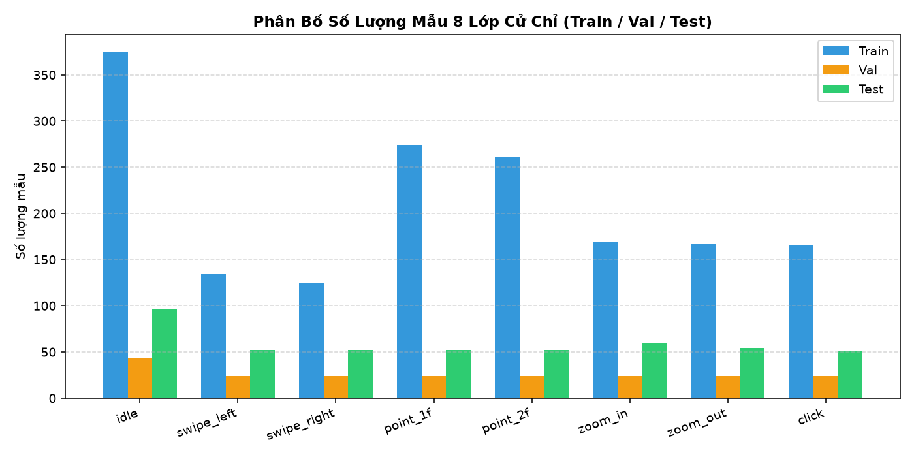
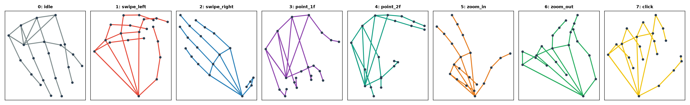
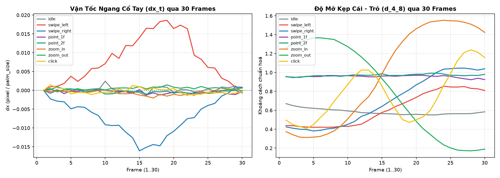
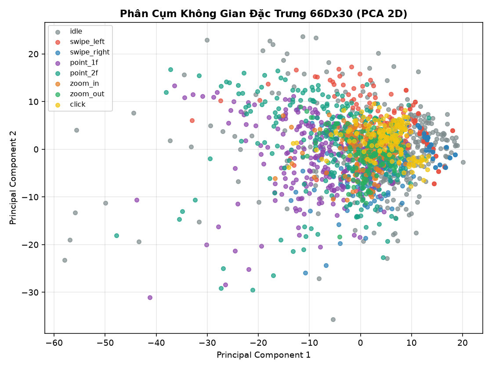
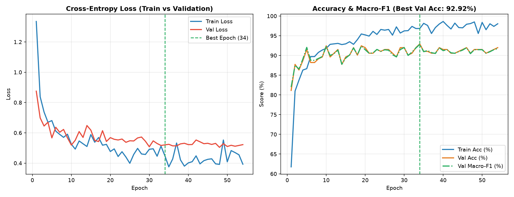
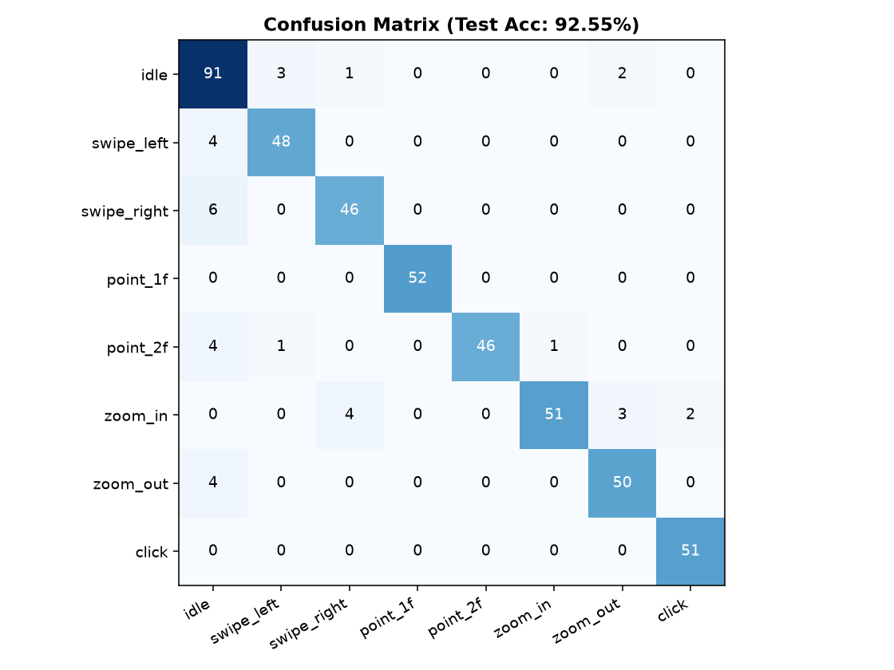

# PowerPoint Hand Control — Nhận Diện Cử Chỉ Tay Động Điều Khiển PowerPoint Thời Gian Thực

Hệ thống **thị giác máy tính & học sâu chuỗi thời gian (Deep Sequence Learning)** cho phép thuyết trình viên điều khiển PowerPoint hoàn toàn không chạm thông qua Webcam chuẩn. Dự án sử dụng **MediaPipe Hands** để trích xuất khung xương `21` khớp 3D (`x, y, z`) và tự thiết kế, huấn luyện từ đầu (**from scratch**) bộ mô hình nơ-ron kép **Model 1 (`StaticPoseNet`) + Model 2 (`HybridConvBiGRUAttention`)** trên bộ dữ liệu công khai **IPN HandS** kết hợp dữ liệu **Webcam cá nhân**, tuân thủ quy trình ML `7` bước và phân tách dữ liệu chống rò rỉ theo từng người quay (`Subject-Independent Split`).

> **Lưu ý phạm vi báo cáo mô hình**: Toàn bộ phân tích dữ liệu, biểu đồ và chỉ số đánh giá trong tài liệu này tập trung vào bài toán cốt lõi **nhận diện `8` cử chỉ điều khiển (`StaticPoseNet` + `HybridConvBiGRUAttention`)**. Tính năng vẽ/nắn hình không trung (`laser_ai` / Smart Shape) được trình bày ở phần giao diện ứng dụng như một tiện ích mở rộng hỗ trợ thuyết trình.

---

## 1. Kiến Trúc Tổng Quan & 8 Lớp Cử Chỉ Điều Khiển

| ID | Tên lớp | Ánh xạ IPN HandS / Nguồn | Hành động PowerPoint | Cơ chế suy luận |
|---:|---|---|---|---|
| `0` | `idle` | `0: NOG` + Webcam | Trạng thái nghỉ / an toàn (không gửi phím) | Model 1 & Model 2 |
| `1` | `swipe_left` | `7: TLT` + Webcam | Chuyển sang trang kế tiếp (`Next Slide`) | Model 2 (`30` / `16` frames) |
| `2` | `swipe_right` | `8: TRT` + Webcam | Quay lại trang trước (`Previous Slide`) | Model 2 (`30` / `16` frames) |
| `3` | `point_1f` | `1: P1F` + Webcam | Trỏ Laser / Bút vẽ / Tiện ích viết trên slide | Model 1 (tức thời 1 frame) |
| `4` | `point_2f` | `2: P2F` + Webcam | Tẩy nét mực / Xoá hình vẽ trên slide | Model 1 (tức thời 1 frame) |
| `5` | `zoom_in` | `12: ZIN` + Webcam | Phóng to nội dung (`Ctrl + =`) | Model 2 (`30` frames) |
| `6` | `zoom_out` | `13: ZOT` + Webcam | Thu nhỏ nội dung (`Ctrl + -`) | Model 2 (`30` frames) |
| `7` | `click` | `9: OP2` + Webcam | Click chuột trái (`Left Click`) tại vị trí trỏ | Model 2 (`30` frames) |

### Tách biệt vai trò AI (Tuân thủ thiết kế kỹ thuật)
1. **MediaPipe Hands ([mediapipe_tracker.py](src/common/mediapipe_tracker.py))**: Chỉ làm nhiệm vụ phát hiện bàn tay và xuất `21` điểm mốc 3D `(x, y, z)` (chạy trên backend `hand_landmarker.task` cho Python 3.14). **Không** dùng `GestureRecognizer` dựng sẵn của MediaPipe.
2. **Model 1 — `StaticPoseNet` ([models.py](src/step4_model_selection/models.py))**: Nhận tensor đặc trưng hình học bất biến xoay 2D `(9, 21)` từ `1` khung hình đơn để kích hoạt tức thì `point_1f` / `point_2f` khi người dùng giơ ngón trỏ hoặc 2 ngón.
3. **Model 2 — `HybridConvBiGRUAttention` ([models.py](src/step4_model_selection/models.py))**: Mô hình chính nhận chuỗi `(30, 66)` gồm `63` đặc trưng tư thế chuẩn hoá theo cổ tay/kích thước lòng bàn tay + `3` vận tốc cổ tay $(\Delta x_t, \Delta y_t, \Delta z_t)$ qua các luồng Multi-Scale Dilated Conv1D + Squeeze-and-Excitation + Kinematic Conv1D + BiGRU + Temporal Attention Pooling để phân loại chính xác `8` lớp cử chỉ động.

---

## 2. Nguồn Dữ Liệu & Liên Kết Thư Mục (`data/`)

- **Dữ liệu gốc IPN HandS (`200` video liên tục, `30 FPS` — tổng `801,476` khung hình ≈ `7.42` giờ)**: [data/ipn_hands/](data/ipn_hands/)
  - Mỗi tệp IPN HandS là phiên quay liên tục dài từ **`3,601` đến `5,060` frames** (`120.0s–168.7s`, trung vị `3,918.5` frames ≈ `130.6s`), chứa trung bình `38.8` phân đoạn (`25.9` cử chỉ chủ động xen kẽ khoảng nghỉ `0: NOG`; toàn bộ `200` video gồm `7,763` phân đoạn trên `15` lớp `0..14`).
  - Danh sách phân chia chuẩn: [train_list.txt](data/ipn_hands/IPN_HandS_annotations/splits/train_list.txt) (`148` videos, `588,795` frames ≈ `5.45` giờ, `37` người quay) và [test_list.txt](data/ipn_hands/IPN_HandS_annotations/splits/test_list.txt) (`52` videos, `212,681` frames ≈ `1.97` giờ, `13` người hoàn toàn khác) — **`0` video và `0` `subject_id` trùng lặp**.
  - Nhãn phân đoạn thời gian (`200` tệp): [temporal_annotations/](data/ipn_hands/IPN_HandS_annotations/temporal_annotations/)
  - Toạ độ khung xương 21 khớp gốc 30 FPS (`200` tệp JSON): [landmarks_gt/](data/ipn_hands/IPN_HandS_landmarks_GT/landmarks_gt/)
  - Bảng lớp gốc IPN HandS: [classes.txt](data/ipn_hands/IPN_HandS_annotations/classes.txt)
- **Dữ liệu thô đã cắt phân đoạn (IPN + Webcam cá nhân)**: [data/raw_sequences/](data/raw_sequences/) (**`2,581`** tệp `.npy` thuộc `8` lớp: **`2,089`** mẫu IPN [`1,619` Train pool + `470` Test] + **`492`** clip Webcam `1280x720`) và bảng chỉ mục [metadata.csv](data/raw_sequences/metadata.csv).
- **Dữ liệu Frame-level cho Model 1 (`StaticPoseNet`, tensor `(9, 21)`)**: **`26,623` khung hình** trích trực tiếp từ `raw30_*.npy` gồm `22,193` Train (`[12,563, 4,932, 4,698]`), `1,244` Val (`[908, 168, 168]`), `2,752` Test độc lập (`[2,024, 364, 364]`) và `434` Webcam Clean (`[322, 63, 49]`).
- **Dữ liệu tensor đã làm sạch & trích xuất đặc trưng**: [data/processed/](data/processed/)
  - Chuỗi đặc trưng 66D: [X_train.npy](data/processed/X_train.npy), [X_val.npy](data/processed/X_val.npy), [X_test.npy](data/processed/X_test.npy), [X_webcam_clean.npy](data/processed/X_webcam_clean.npy)
  - Chuỗi khung xương thô 30 frames `63D` (cho `StaticPoseNet` & replay): [raw30_train.npy](data/processed/raw30_train.npy), [raw30_val.npy](data/processed/raw30_val.npy), [raw30_test.npy](data/processed/raw30_test.npy), [raw30_webcam_clean.npy](data/processed/raw30_webcam_clean.npy)
  - Nhãn lớp: [y_train.npy](data/processed/y_train.npy), [y_val.npy](data/processed/y_val.npy), [y_test.npy](data/processed/y_test.npy), [y_webcam_clean.npy](data/processed/y_webcam_clean.npy)
  - Kiểm toán chống rò rỉ hash & khoảng cách Euclidean `X_test -> X_train`: `0` hash SHA-256 trùng; `L2 min = 2.6957`, `median = 8.7668`, `mean = 9.4041`, `max = 34.4788`.
- **Báo cáo thống kê tiền xử lý**: [outputs/diagnostics/data_report.json](outputs/diagnostics/data_report.json)

---

## 3. Tiền Xử Lý Dữ Liệu & Chẩn Đoán (Step 2 & Step 3)

Quy trình ở [clean_diagnose_pipeline.py](src/step2_clean_diagnose/clean_diagnose_pipeline.py) thực hiện:
1. Nội suy tuyến tính frame khuyết (`interpolate_missing_frames`, loại bỏ chuỗi mất dấu `> 25%`).
2. Đồng bộ độ dài chuỗi về cố định $T = 30$ frames bằng nội suy thời gian (`temporal_resample`).
3. Kiểm định động học cơ sinh học (`audit_sequence_kinematics` trong [kinematic_audit.py](src/step2_clean_diagnose/kinematic_audit.py)) để loại bỏ mẫu lỗi thao tác / ngược hướng.
4. Trích xuất `66` đặc trưng/frame (`extract_66d_dynamic_features` trong [feature_extractor.py](src/step2_clean_diagnose/feature_extractor.py)).
5. Chia `train / val` theo **Subject ID** (`31` người Train / `6` người Val), giữ nguyên `52` video (`13` người lạ) làm tập Test độc lập, và tách `15%` mẫu Webcam sạch làm tập `X_webcam_clean.npy`.

| Lớp cử chỉ | Tổng thô | Bị loại | Nội suy | Giữ lại sạch | Train (`1,671`) | Val (`212`) | Test (`470`) | Webcam (Thu / Đạt) | Độ dài TB (min–max) |
|---|---:|---:|---:|---:|---:|---:|---:|---:|---|
| `idle` | `542` | `0` | `25` | `542` | `375` | `44` | `97` | `175 / 175` | `29.9` (`20–32`) |
| `swipe_left` | `233` | `42` | `13` | `191` | `134` | `24` | `52` | `36 / 27` | `30.1` (`11–59`) |
| `swipe_right` | `225` | `41` | `4` | `184` | `125` | `24` | `52` | `30 / 25` | `29.8` (`10–52`) |
| `point_1f` | `408` | `25` | `0` | `359` | `274` | `24` | `52` | `60 / 60` | `31.5` (`20–32`) |
| `point_2f` | `393` | `25` | `1` | `344` | `261` | `24` | `52` | `45 / 45` | `31.6` (`21–32`) |
| `zoom_in` | `272` | `11` | `0` | `258` | `169` | `24` | `60` | `40 / 32` | `35.4` (`11–92`) |
| `zoom_out` | `258` | `3` | `1` | `252` | `167` | `24` | `54` | `50 / 48` | `34.0` (`13–83`) |
| `click` | `250` | `1` | `0` | `249` | `166` | `24` | `51` | `56 / 56` | `47.3` (`21–121`) |
| **Tổng cộng** | **`2,581`** | **`148`** | **`44`** | **`2,379`** | **`1,671`** | **`212`** | **`470`** | **`492 / 468`** | — |

### Trực quan hoá dữ liệu (EDA — [plot_diagnostics.py](src/step3_visualization/plot_diagnostics.py))

1. **Phân bố số lượng mẫu giữa Train / Val / Test trên 8 lớp** ([fig1_class_and_length_distribution.png](outputs/figures/fig1_class_and_length_distribution.png)):
   

2. **Cấu trúc khung xương 21 khớp chuẩn MediaPipe của 8 lớp** ([fig2_hand_skeletons_8classes.png](outputs/figures/fig2_hand_skeletons_8classes.png)):
   

3. **Đặc trưng vận tốc ngang cổ tay (`dx_t`) và độ mở kẹp Cái–Trỏ (`d_4_8`) qua 30 frames** ([fig3_velocity_and_aperture_profiles.png](outputs/figures/fig3_velocity_and_aperture_profiles.png)):
   

4. **Chiếu không gian đặc trưng `66D x 30` xuống PCA 2D** ([fig4_feature_space_projection.png](outputs/figures/fig4_feature_space_projection.png)):
   

---

## 4. Kiến Trúc Mô Hình & Quá Trình Huấn Luyện Từ Đầu (Step 4 & Step 5)

### 4.1. So sánh kiến trúc ([model_comparison.json](outputs/diagnostics/model_comparison.json))

| Mô hình | Lớp Python | Tham số | Dung lượng | Tensor vào $\rightarrow$ ra | Latency CPU (1 mẫu / Batch 32) | Vai trò |
|---|---|---:|---:|---|---|---|
| **StaticPoseNet (Model 1)** | `StaticPoseNet` | `60,467` | `236.20 KB` | `(32, 9, 21) -> (32, 3)` | `0.393 ms` / `0.787 ms` | Nhận diện tư thế chỉ 1/2 ngón tức thời |
| Temporal 1D-CNN | `TemporalCNN1D` | `93,000` | `363.28 KB` | `(32, 30, 66) -> (32, 8)` | `0.460 ms` / `1.796 ms` | Kiến trúc đối chứng tham khảo |
| BiLSTM | `BiLSTMClassifier` | `69,984` | `273.38 KB` | `(32, 30, 66) -> (32, 8)` | `0.571 ms` / `1.223 ms` | Kiến trúc đối chứng tham khảo |
| **Hybrid Conv-BiGRU-Attn (Model 2)** | `HybridConvBiGRUAttention` | `91,964` | `359.23 KB` | `(32, 30, 66) -> (32, 8)` | `3.219 ms` / `7.058 ms` | **Mô hình chính được huấn luyện & triển khai** |

### 4.2. Cấu hình & kết quả huấn luyện ([train.py](src/step5_training/train.py), [training_history.json](outputs/diagnostics/training_history.json))

- **Model 2 (`HybridConvBiGRUAttention` -> [best_gesture_model.pt](outputs/models/best_gesture_model.pt), `390,349` bytes)**:
  - `91,964` trainable weights (`92,338` tổng phần tử gồm `374` BatchNorm buffers, `61` tensors), AdamW (`lr=1e-3`, `weight_decay=8e-4`), ReduceLROnPlateau (`factor=0.5`, `patience=6`), Balanced Cross-Entropy (`label_smoothing=0.05`), Sequence Mixup (`alpha=0.20`, xác suất `25%`), Dropout `0.28`, Batch `32`, Data Augmentation (lật gương đảo `swipe_left <-> swipe_right`, xoay 2D `±40°`, nghiêng 3D, nhiễu Gaussian, drift, speed warp `22..29`, frame shift/dropout).
  - Huấn luyện `54` epochs (`105.1s` CPU); **Best Checkpoint @ Epoch `34`**:
    - `Train Acc = 96.83%` | `Train Macro-F1 = 97.17%`
    - `Val Loss = 0.5204` | `Val Acc = 92.92%` | `Val Macro-F1 = 92.82%` (`212` mẫu từ `6` người lạ)
    - `Webcam Clean Acc = 95.71%` | `Webcam Clean Macro-F1 = 96.21%` (`70` mẫu holdout cá nhân)
- **Model 1 (`StaticPoseNet` -> [best_pose_model.pt](outputs/models/best_pose_model.pt), `248,611` bytes)**:
  - `60,467` trainable weights (`16` tensors, `base_aspect = 4:3`), AdamW (`lr=1e-3`, `weight_decay=4e-4`), CosineAnnealingLR (`T_max=35`), Weighted Cross-Entropy (`pow=0.68`, `label_smoothing=0.02`), Dropout `0.15`, Batch `128`, Early Stopping `patience=18` trên `22,193` train frames / `1,244` val frames / `434` webcam clean frames.
  - **Best Checkpoint @ Epoch `3`**:
    - `Train Acc = 93.46%` | `Val Loss = 0.2340` | `Val Acc = 95.34%` | `Val Macro-F1 = 92.75%`
    - `Webcam Clean Acc = 98.16%` | `Webcam Clean Macro-F1 = 97.10%`



---

## 5. Kết Quả Đánh Giá Độc Lập Trên Tập Test (Step 6 — [test_evaluation_report.json](outputs/diagnostics/test_evaluation_report.json))

### 5.1. Model 2 — `HybridConvBiGRUAttention` (`470` chuỗi từ `52` video / `13` người hoàn toàn độc lập)

- **Test Accuracy**: **`92.55%`** (`435/470` mẫu đúng)
- **Test Macro-F1**: **`93.09%`** (`Macro Precision = 93.90%`, `Macro Recall = 92.58%`)
- **Test Weighted-F1**: **`92.59%`** | **Độ trễ suy luận 1 cửa sổ CPU**: **`4.067 ms`** (`~245 FPS`)

| Lớp (`0..7`) | Precision | Recall | F1-Score | Support |
|---|---:|---:|---:|---:|
| `0: idle` | `83.49%` | `93.81%` | `88.35%` | `97` |
| `1: swipe_left` | `92.31%` | `92.31%` | `92.31%` | `52` |
| `2: swipe_right` | `90.20%` | `88.46%` | `89.32%` | `52` |
| `3: point_1f` | `100.00%` | `100.00%` | `100.00%` | `52` |
| `4: point_2f` | `100.00%` | `88.46%` | `93.88%` | `52` |
| `5: zoom_in` | `98.08%` | `85.00%` | `91.07%` | `60` |
| `6: zoom_out` | `90.91%` | `92.59%` | `91.74%` | `54` |
| `7: click` | `96.23%` | `100.00%` | `98.08%` | `51` |



**Kiểm định ngưỡng tin cậy triển khai (`Confidence Gate Audit`):**

| Ngưỡng (`threshold`) | Gated Accuracy | Gated Macro-F1 | Idle False Positive Rate | Active Command Precision |
|---:|---:|---:|---:|---:|
| `0.00` | `92.55%` | `93.09%` | `6.19%` (`6/97`) | `95.29%` |
| `0.70` | `88.51%` | `90.10%` | `5.15%` (`5/97`) | `97.01%` |
| `0.80` | `86.81%` | `88.63%` | `4.12%` (`4/97`) | `97.22%` |
| **`0.85` (mặc định)** | **`85.96%`** | **`87.87%`** | **`3.09%` (`3/97`)** | **`97.48%`** |
| `0.90` | `82.34%` | `84.64%` | `2.06%` (`2/97`) | `97.99%` |

### 5.2. Model 1 — `StaticPoseNet` (`2,752` Test frames từ vùng tâm chuỗi ổn định)

- **Pose Test Accuracy**: **`93.53%`** | **Macro-F1**: **`87.91%`** (`Macro Precision = 89.59%`, `Macro Recall = 86.40%`) | **Weighted-F1**: **`93.39%`** | **Latency CPU**: **`0.253 ms`/frame**

| Lớp tư thế | Precision | Recall | F1-Score | Support |
|---|---:|---:|---:|---:|
| `other_pose` | `95.81%` | `98.22%` | `97.00%` | `2,024` |
| `point_1f` | `89.63%` | `85.44%` | `87.48%` | `364` |
| `point_2f` | `83.33%` | `75.55%` | `79.25%` | `364` |

---

## 6. Giao Diện Ứng Dụng & Triển Khai PowerPoint (Step 7)

Ứng dụng Desktop ([app_gui.py](src/app_gui.py), mở nhanh bằng [Run_GUI.bat](Run_GUI.bat)) và bộ điều khiển thời gian thực ([controller.py](src/step7_deployment/controller.py), [deploy.py](src/step7_deployment/deploy.py), [hud.py](src/step7_deployment/hud.py), [win32_input.py](src/common/win32_input.py)):
- **Giao diện Desktop 3 tab**:
  1. *Thiết Lập Nhanh & Chế Độ*: Chọn 5 chế độ điều khiển 1 ngón (`laser_ai`, `laser_pen`, `ai_shapes`, `pen`, `laser`), chọn Camera, vị trí cửa sổ PiP 4 góc màn hình và khoá an toàn chỉ gửi lệnh khi PowerPoint đang hoạt động (`ppt_only_lock`), tự lưu vào [user_settings.json](outputs/user_settings.json).
  2. *Cử Chỉ & Phím Tắt*: Tra cứu đủ `8` cử chỉ và các phím tắt điều khiển (`1/2/3`, `C`, `D`, `M`, `F8`, `F9`, `Q`).
  3. *Tinh Chỉnh AI & Thu Mẫu*: Điều chỉnh `conf_threshold`, `cooldown_sec`, `pointer_smoothing`, xem thông số model thực tế và mở công cụ thu mẫu Webcam (`--step 1b`).
- **Tiện ích mở rộng trên Slide (`laser_ai` / Air-Ink)**: Khi trình chiếu Slide Show ở chế độ mặc định `laser_ai`, người dùng di chuyển ngón trỏ để dùng **Con trỏ Laser (`Ctrl+L`)**, giữ yên tay `0.7s` để chuyển sang **Bút vẽ (`Ctrl+P`)** với bộ lọc làm mượt `OneEuroFilter2D`, và hệ thống hỗ trợ nắn gọn nét vẽ thành hình học vector sạch qua PowerPoint COM ([smart_shape.py](src/step7_deployment/smart_shape.py)) trước khi tự trả về Laser.
- **Lớp bảo vệ an toàn**: Kết hợp Sliding Window `30` frames, Confidence Gate (`0.85`), Majority Voting (`3` frames / `2` cho vuốt nhanh), Cooldown (`2.0s` / `1.05s` tối thiểu cho vuốt), vùng chết đáy màn hình (`bottom_deadzone`), và phím tạm dừng/thoát khẩn cấp (`F9` / `Q` / `ESC`).

---

## 7. Cấu Trúc Dự Án & Hướng Dẫn Chạy Nhanh

```text
d:\SIC\
├── main.py                      # Điểm vào thống nhất cho GUI và tất cả các bước
├── Run_GUI.bat                  # Mở nhanh giao diện Desktop GUI
├── build_app.py                 # Đóng gói ứng dụng .exe bằng PyInstaller
├── data/                        # Dữ liệu IPN HandS, raw_sequences và tensor processed
├── outputs/
│   ├── models/                  # Trọng số .pt & MediaPipe hand_landmarker.task
│   ├── figures/                 # Biểu đồ phân tích dữ liệu, huấn luyện & đánh giá
│   └── diagnostics/             # Báo cáo JSON chuẩn xác từng bước
└── src/
    ├── app_gui.py               # Bảng điều khiển GUI Tkinter
    ├── common/                  # config.py, mediapipe_tracker.py, win32_input.py
    ├── step1_data_collection/   # prepare_ipn_hands.py, collect_webcam.py, ...
    ├── step2_clean_diagnose/    # clean_diagnose_pipeline.py, feature_extractor.py, kinematic_audit.py
    ├── step3_visualization/     # plot_diagnostics.py, view_ipn_gestures.py
    ├── step4_model_selection/   # models.py
    ├── step5_training/          # train.py, dataset.py, pose_dataset.py
    ├── step6_evaluation/        # evaluate.py
    └── step7_deployment/        # deploy.py, controller.py, hud.py, smart_shape.py
```

```bash
# 1. Mở giao diện người dùng (GUI Launcher)
python main.py --gui

# 2. Chạy từng bước quy trình học máy (1 -> 7)
python main.py --step 1a         # Trích xuất dữ liệu IPN HandS theo split gốc
python main.py --step 1b         # Thu thập mẫu Webcam bổ sung cho 8 lớp
python main.py --step 2          # Làm sạch, kiểm định động học & trích xuất đặc trưng 66D
python main.py --step 3          # Xuất biểu đồ EDA (fig1..fig4)
python main.py --step 4          # Benchmark số tham số & tốc độ các kiến trúc
python main.py --step 5          # Huấn luyện từ đầu Model 1 & Model 2 (--arch hybrid)
python main.py --step 6          # Đánh giá trên tập Test độc lập & xuất fig6
python main.py --step 7          # Chạy điều khiển PowerPoint thời gian thực

# 3. Đóng gói bản .exe độc lập trên Windows
python build_app.py
```
